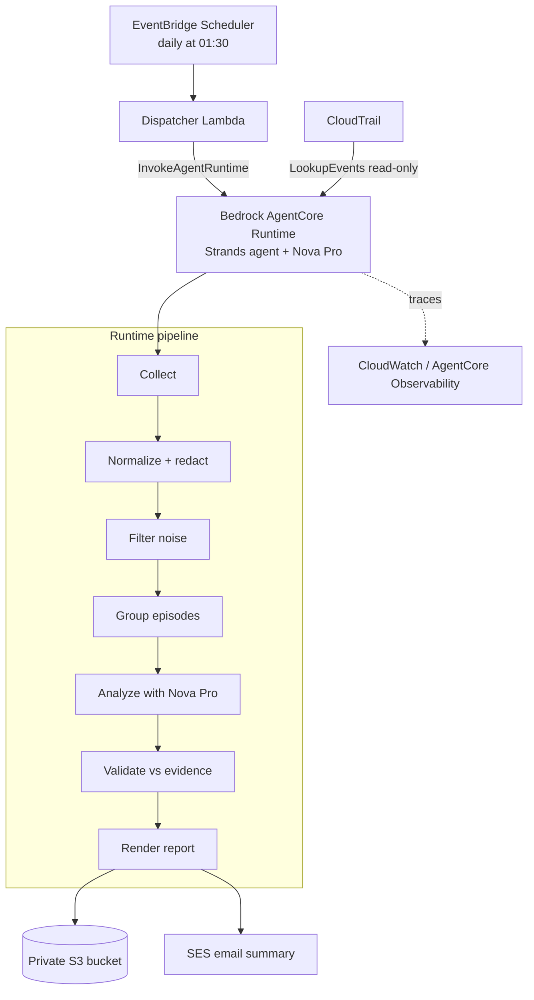

# Archival Agent

A personal, always-on AWS operations analyst. Once a day it reviews the previous day's AWS activity, removes the noise, groups related events into operational "episodes", uses an AI agent to investigate the significant ones, validates every claim against the source events, stores a detailed report in S3, and emails you a summary.

It is **read-only**. It inspects CloudTrail, explains what happened, and recommends follow-ups. It never changes anything in your account.

Built for the AWS Builder Center *Weekend Agent Challenge* with the [Strands Agents SDK](https://strandsagents.com/), Amazon Nova Pro, and Amazon Bedrock AgentCore Runtime.

---

## What it does

Every day, on a schedule, and with no button to press:

1. Calculates the previous day's local time window.
2. Collects CloudTrail management events across your configured regions (plus `us-east-1` for global-service activity such as IAM).
3. Normalizes the events and **redacts secrets**; drops read-only noise, routine polling, and the agent's own activity.
4. Groups related events into **episodes** (a stack deployment or a security-group change becomes one story instead of many rows).
5. Sends the significant episodes to a **Strands agent on Amazon Nova Pro**, which investigates them with read-only tools.
6. Runs a **deterministic validator** over the AI output: every fact must point to a real event ID, destructive or invented claims are rejected, and it falls back to a plain deterministic report if the AI output does not hold up.
7. Renders an HTML + JSON report and stores it in a private S3 bucket.
8. Emails a summary via SES with the headline, totals, failures, and top recommendations.
9. Emits traces, model calls, and tool calls to CloudWatch through AgentCore Observability.

## Architecture



The trigger is EventBridge Scheduler. It invokes a small dispatcher Lambda, which calls `InvokeAgentRuntime`. The runtime runs the whole pipeline and returns a compact status.

## AWS services

| Service | Role |
|---|---|
| Amazon Bedrock AgentCore Runtime | Hosts the agent as an ARM64 container |
| Amazon Bedrock (Nova Pro) | Foundation model |
| Strands Agents SDK | Agent framework and read-only tools |
| Amazon EventBridge Scheduler | Daily trigger |
| AWS Lambda | Dispatcher that invokes the runtime |
| AWS CloudTrail | Activity source (`LookupEvents`) |
| Amazon S3 | Private report storage |
| Amazon SES | Email summary |
| Amazon CloudWatch / AgentCore Observability | Traces, model and tool calls |
| AWS SAM + IAM | Infrastructure and least-privilege roles |

## Repository layout

```
archival-agent/
├── agent/                  # Runtime application
│   ├── app.py              # AgentCore entrypoint + run orchestration
│   ├── config.py           # Env-driven configuration + rule loading
│   ├── collector.py        # CloudTrail collection (paginated, per-region)
│   ├── normalizer.py       # Parse, redact, allowlist request params
│   ├── filters.py          # Deterministic classify + noise filtering
│   ├── grouper.py          # Correlate events into episodes
│   ├── analyst.py          # Strands agent + Nova Pro (two-phase analysis)
│   ├── validator.py        # Evidence validation + deterministic fallback
│   ├── renderer.py         # HTML + JSON report rendering
│   ├── notifier.py         # SES email
│   ├── idempotency.py      # Completed markers + run lock
│   ├── storage.py          # S3 helpers
│   ├── models/             # Pydantic models
│   └── tools/              # Read-only Strands tools
├── dispatcher/             # Dispatcher Lambda (handler.py)
├── infrastructure/         # AWS SAM template + example parameters
├── deploy/                 # Runtime image build + registration scripts
├── rules/                  # Deterministic rules (filtering, redaction, etc.)
├── prompts/                # System prompt
├── templates/              # Jinja2 report + email templates
├── demo/                   # Safe, reproducible demo scenarios
├── Dockerfile              # ARM64 runtime image
└── plan.md                 # Design document
```

## How the AI stays trustworthy

- **Deterministic first.** Collection, redaction, filtering, and grouping are plain code. The model only sees a clean episode index, and all counts come from code, not the model.
- **Grounding.** Every fact and recommendation must cite real event IDs. The validator drops unknown IDs, rejects destructive advice and permission-expansion, rejects unsupported before/after or cost claims, and enforces a recommendation allowlist and a maximum of five recommendations.
- **Fallback.** If the model errors or its output fails validation, the run produces a deterministic report from the episode summaries instead. The run never claims AI success when it did not happen.
- **Read-only.** The agent's tools can only read the current run's evidence and previous reports. There is no tool that changes AWS.

## Prerequisites

- An AWS account with credentials configured
- Python 3.12
- AWS SAM CLI
- Docker (for the ARM64 runtime image)
- Amazon Bedrock access to Nova Pro (`amazon.nova-pro-v1:0`) in your agent region (`us-east-1`)
- Two verified Amazon SES identities (sender and recipient); if SES is in sandbox, both must be verified
- CloudWatch Transaction Search enabled (for AgentCore Observability traces)

## Deploy

The stack deploys in two passes because the AgentCore Runtime is registered separately from the supporting infrastructure.

**1. Supporting infrastructure (S3 bucket, dispatcher, IAM roles, disabled scheduler):**

```bash
sam build
sam deploy --guided \
  --capabilities CAPABILITY_NAMED_IAM \
  --parameter-overrides \
    Timezone=Asia/Kolkata \
    AuditRegions=ap-south-1,us-east-1 \
    NovaModelId=amazon.nova-pro-v1:0 \
    SesSenderEmail=you@example.com \
    SesRecipientEmail=you@example.com
```

Note: do not override `ScheduleExpression` on the CLI. The SAM CLI splits parameter values on spaces and corrupts the cron. The template default (`cron(30 1 * * ? *)`) is used automatically; change it in the template if needed.

**2. Build and register the runtime** using the `RuntimeExecutionRoleArn` from the stack outputs:

```bash
RUNTIME_ROLE_ARN=<RuntimeExecutionRoleArn output> \
SES_SENDER=you@example.com SES_RECIPIENT=you@example.com \
AGENT_REGION=us-east-1 \
./deploy/deploy_runtime.sh
```

This builds the ARM64 image, pushes it to ECR, and calls `create_agent_runtime`. It prints the runtime ARN.

**3. Wire the runtime ARN back into the stack** so the dispatcher can invoke it:

```bash
sam deploy --parameter-overrides AgentRuntimeArn=<runtime arn> ...
```

**4. Smoke test** (invoke the dispatcher directly; a full run takes a couple of minutes):

```bash
aws lambda invoke --function-name archival-agent-dispatcher \
  --payload '{"jobType":"DAILY_ARCHIVAL","timezone":"Asia/Kolkata","auditRegions":["ap-south-1"],"force":true}' \
  --cli-binary-format raw-in-base64-out --cli-read-timeout 0 out.json && cat out.json
```

**5. Enable the daily schedule** once a manual run works:

```bash
sam deploy --parameter-overrides ScheduleState=ENABLED ...
```

## Configuration

Runtime environment variables (set on the AgentCore runtime):

| Variable | Default | Purpose |
|---|---|---|
| `AWS_ACCOUNT_ID` | (from STS) | Account under audit |
| `AGENT_REGION` | `us-east-1` | Region for Bedrock, S3, SES |
| `NOVA_MODEL_ID` | `amazon.nova-pro-v1:0` | Foundation model |
| `REPORT_BUCKET` | `archival-agent-<account>` | Report storage bucket |
| `SES_SENDER` / `SES_RECIPIENT` | (empty) | Email identities; empty skips email |
| `MAX_AGENT_EPISODES` | `25` | Episodes the agent investigates |
| `MAX_TOOL_RECORDS` | `20` | Max events returned per tool call |
| `NOVA_MAX_TOKENS` | `5120` | Model output token cap |

Invocation payload fields:

| Field | Default | Purpose |
|---|---|---|
| `timezone` | `UTC` | Local timezone for the report window |
| `auditRegions` | `[]` | Regions to audit |
| `force` | `false` | Reprocess even if already completed |
| `windowDaysAgo` | `1` | `1` = previous day, `0` = today so far, `N` = N days ago |
| `includeGlobalRegion` | `true` | Add `us-east-1` automatically; `false` scopes to the listed regions |

## Demo

`demo/scenario_runner.py` performs safe, prefixed, tagged AWS operations (an SQS queue, a successful and a failing CloudFormation stack, a security-group change, and a deliberate duplicate-rule failure) so a run has real activity to analyze. Clean up afterward with `demo/cleanup.py`.

```bash
python demo/scenario_runner.py                 # create demo activity
python demo/cleanup.py --discover              # remove it
```

Every demo resource is prefixed `archival-agent-demo-` and tagged `archival-agent:demo=true`, and cleanup refuses to touch anything that is not.

## Security notes

- The agent is read-only and cannot modify AWS.
- Secrets, tokens, environment values, and request bodies are redacted during normalization; request parameters are allowlisted.
- Reports are stored in a private, encrypted, TLS-only S3 bucket. Links are presigned and expire.
- Event content is treated as untrusted data and is never interpreted as instructions.

## License

MIT (or your choice).
