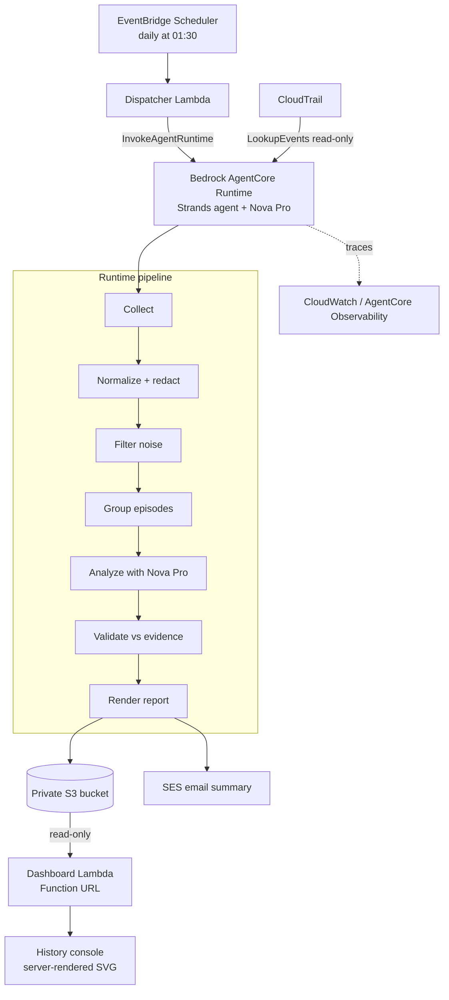

# Archival Agent

A personal, always-on AWS operations analyst. Once a day it reviews the previous day's AWS activity, removes the noise, groups related events into operational "episodes", uses an AI agent to investigate the significant ones, validates every claim against the source events, stores a detailed report in S3, and emails you a summary. A read-only web console charts the history so you can see trends instead of isolated days.

It is **read-only**. It inspects CloudTrail, explains what happened, and recommends follow-ups. It never changes anything in your account.

Built for the AWS Builder Center *Weekend Agent Challenge*, then extended for the *Weekend Showcase Challenge*, with the [Strands Agents SDK](https://strandsagents.com/), Amazon Nova Pro, and Amazon Bedrock AgentCore Runtime.

---

## New: it explains *why* access was denied

*Added for the AWS Builder Center Weekend Challenge: Give your Agent a Tool.* · **[Demo video (2:19)](https://youtu.be/yBqx_8mTaTg)** · **[Sample report](https://archival-agent-demo-report-0cfc20.s3.us-east-1.amazonaws.com/archival-agent-access-denied-sample.html)**

`AccessDenied` is the most common failure in this agent's reports: 2,347 denied calls in October alone. Until now, the reports could only say that a call was denied, and the limitations section admitted "the specific permissions required … are not identified."

The new Strands tool, **`diagnose_access_denied`** (`agent/tools/access_diagnosis.py`), closes that gap:

1. Parses the principal, action, resource and AWS's stated reason from the CloudTrail error.
2. Asks the **IAM policy simulator** why the call was denied. For KMS, the key policy is included.
3. Classifies the cause: `MISSING_PERMISSION`, `EXPLICIT_DENY`, `BLOCKED_BY_GUARDRAIL`, `NOW_ALLOWED`, `AWS_MANAGED_ROLE` or `CANNOT_DIAGNOSE`.
4. For a missing permission, builds the narrowest statement and **re-runs the simulator with it**. It's only marked "fix verified" if `implicitDeny` becomes `allowed`.
5. Merges identical denials across the day into one diagnosis (`AD-1`, `AD-2`, …).

Guarantees that keep this consistent with the agent's design:

- **The model doesn't write the fix.** Diagnoses are deterministic tool output, rendered as their own report section.
- **The model can only cite diagnoses that exist.** The validator drops recommendations that cite an unknown diagnosis ID.
- **It stays read-only.** It needs `iam:SimulatePrincipalPolicy`, `iam:GetRole`, `iam:GetUser` and `kms:GetKeyPolicy`, and never changes a policy.

To compare the agent with and without the tool on the same real day:

```bash
ACCESS_DIAGNOSIS_ENABLED=false   # the original agent
REPORT_BUCKET=<demo-bucket> AWS_ACCOUNT_ID=<id> python demo/before_after.py --days-ago 1
```

The full write-up is on AWS Builder Center (Weekend Challenge: Give your Agent a Tool).

---

## What it does

Every day, on a schedule, and with no button to press:

1. Calculates the previous day's local time window.
2. Collects CloudTrail management events across your configured regions (plus `us-east-1` for global-service activity such as IAM).
3. Normalizes the events and **redacts secrets**; drops read-only noise, routine polling, and the agent's own activity.
4. Groups related events into **episodes** (a stack deployment or a security-group change becomes one story instead of many rows).
5. Sends the significant episodes to a **Strands agent on Amazon Nova Pro**, which investigates them with read-only tools, including the IAM policy simulator for AccessDenied failures.
6. Runs a **deterministic validator** over the AI output: every fact must point to a real event ID, destructive or invented claims are rejected, and it falls back to a plain deterministic report if the AI output does not hold up.
7. Renders an HTML + JSON report and stores it in a private S3 bucket.
8. Emails a summary via SES with the headline, totals, failures, and top recommendations.
9. Emits traces, model calls, and tool calls to CloudWatch through AgentCore Observability.

Between runs, the **history console** reads the stored reports and charts activity, failures, episode categories, agent health, and how much noise the deterministic filters removed. See [History console](#history-console).

## Architecture



The trigger is EventBridge Scheduler. It invokes a small dispatcher Lambda, which calls `InvokeAgentRuntime`. The runtime runs the whole pipeline and returns a compact status.

The console is a separate Lambda behind a Function URL. It only reads the report bucket, so it cannot affect a run.

## AWS services

| Service | Role |
|---|---|
| Amazon Bedrock AgentCore Runtime | Hosts the agent as an ARM64 container |
| Amazon Bedrock (Nova Pro) | Foundation model |
| Strands Agents SDK | Agent framework and read-only tools |
| Amazon EventBridge Scheduler | Daily trigger |
| AWS Lambda | Dispatcher that invokes the runtime, plus the read-only history console |
| AWS Lambda Function URL | Console endpoint (token-gated) |
| AWS CloudTrail | Activity source (`LookupEvents`) |
| Amazon S3 | Private report storage |
| Amazon SES | Email summary |
| Amazon CloudWatch / AgentCore Observability | Traces, model and tool calls |
| AWS SAM + IAM | Infrastructure and least-privilege roles |

## Repository layout

```
archival-agent/
├── agent/                  # Runtime application
│   ├── app.py              # AgentCore entrypoint + run orchestration
│   ├── config.py           # Env-driven configuration + rule loading
│   ├── collector.py        # CloudTrail collection (paginated, per-region)
│   ├── normalizer.py       # Parse, redact, allowlist request params
│   ├── filters.py          # Deterministic classify + noise filtering
│   ├── grouper.py          # Correlate events into episodes
│   ├── analyst.py          # Strands agent + Nova Pro (two-phase analysis)
│   ├── validator.py        # Evidence validation + deterministic fallback
│   ├── renderer.py         # HTML + JSON report rendering
│   ├── notifier.py         # SES email
│   ├── idempotency.py      # Completed markers + run lock
│   ├── storage.py          # S3 helpers
│   ├── models/             # Pydantic models
│   └── tools/              # Read-only Strands tools
├── dispatcher/             # Dispatcher Lambda (handler.py)
├── dashboard/              # History console Lambda (read-only)
│   ├── handler.py          # Routing + token auth
│   ├── history.py          # Reads/aggregates stored reports from S3
│   ├── charts.py           # Server-rendered inline SVG (no JS, no CDN)
│   ├── render.py           # Jinja2 environment
│   └── templates/          # Console template
├── infrastructure/         # AWS SAM template + example parameters
├── deploy/                 # Runtime image build + registration scripts
├── rules/                  # Deterministic rules (filtering, redaction, etc.)
├── prompts/                # System prompt
├── templates/              # Jinja2 report + email templates
├── demo/                   # Safe, reproducible demo scenarios
├── Dockerfile              # ARM64 runtime image
└── plan.md                 # Design document
```

## How the AI stays trustworthy

- **Deterministic first.** Collection, redaction, filtering, and grouping are plain code. The model only sees a clean episode index, and all counts come from code, not the model.
- **Grounding.** Every fact and recommendation must cite real event IDs. The validator drops unknown IDs, rejects destructive advice and permission-expansion, rejects unsupported before/after or cost claims, and enforces a recommendation allowlist and a maximum of five recommendations.
- **Fallback.** If the model errors or its output fails validation, the run produces a deterministic report from the episode summaries instead. The run never claims AI success when it did not happen.
- **Read-only.** The agent's tools can only read the current run's evidence and previous reports. There is no tool that changes AWS.

## Prerequisites

- An AWS account with credentials configured
- Python 3.12
- AWS SAM CLI
- Docker (for the ARM64 runtime image)
- Amazon Bedrock access to Nova Pro (`amazon.nova-pro-v1:0`) in your agent region (`us-east-1`)
- Two verified Amazon SES identities (sender and recipient); if SES is in sandbox, both must be verified
- CloudWatch Transaction Search enabled (for AgentCore Observability traces)

## Deploy

The stack deploys in two passes because the AgentCore Runtime is registered separately from the supporting infrastructure.

**1. Supporting infrastructure (S3 bucket, dispatcher, IAM roles, disabled scheduler):**

```bash
sam build
sam deploy --guided \
  --capabilities CAPABILITY_NAMED_IAM \
  --parameter-overrides \
    Timezone=Asia/Kolkata \
    AuditRegions=ap-south-1,us-east-1 \
    NovaModelId=amazon.nova-pro-v1:0 \
    SesSenderEmail=you@example.com \
    SesRecipientEmail=you@example.com
```

Note: do not override `ScheduleExpression` on the CLI. The SAM CLI splits parameter values on spaces and corrupts the cron. The template default (`cron(30 1 * * ? *)`) is used automatically; change it in the template if needed.

**2. Build and register the runtime** using the `RuntimeExecutionRoleArn` from the stack outputs:

```bash
RUNTIME_ROLE_ARN=<RuntimeExecutionRoleArn output> \
SES_SENDER=you@example.com SES_RECIPIENT=you@example.com \
AGENT_REGION=us-east-1 \
./deploy/deploy_runtime.sh
```

This builds the ARM64 image, pushes it to ECR, and calls `create_agent_runtime`. It prints the runtime ARN.

**3. Wire the runtime ARN back into the stack** so the dispatcher can invoke it:

```bash
sam deploy --parameter-overrides AgentRuntimeArn=<runtime arn> ...
```

**4. Smoke test** (invoke the dispatcher directly; a full run takes a couple of minutes):

```bash
aws lambda invoke --function-name archival-agent-dispatcher \
  --payload '{"jobType":"DAILY_ARCHIVAL","timezone":"Asia/Kolkata","auditRegions":["ap-south-1"],"force":true}' \
  --cli-binary-format raw-in-base64-out --cli-read-timeout 0 out.json && cat out.json
```

**5. Enable the daily schedule** once a manual run works:

```bash
sam deploy --parameter-overrides ScheduleState=ENABLED ...
```

**6. Set a console token** so the history dashboard will serve data. Add
`DashboardToken=<random string>` to `parameter_overrides` in `samconfig.toml` and
run `sam deploy`. Until it is set, the console returns 503. See
[History console](#history-console).

> Prefer editing `samconfig.toml` over passing `--parameter-overrides` on the CLI.
> Parameters you omit fall back to template defaults, which would silently reset
> `ScheduleState` to `DISABLED` and re-widen the dispatcher's IAM policy.

Changes under `agent/`, `prompts/`, `rules/`, or `templates/` live in the
container image, so they need `./deploy/deploy_runtime.sh` again. `sam deploy`
alone only updates the dispatcher, the console, and the infrastructure.

## Configuration

Runtime environment variables (set on the AgentCore runtime):

| Variable | Default | Purpose |
|---|---|---|
| `AWS_ACCOUNT_ID` | (from STS) | Account under audit |
| `AGENT_REGION` | `us-east-1` | Region for Bedrock, S3, SES |
| `NOVA_MODEL_ID` | `amazon.nova-pro-v1:0` | Foundation model |
| `REPORT_BUCKET` | `archival-agent-<account>` | Report storage bucket |
| `SES_SENDER` / `SES_RECIPIENT` | (empty) | Email identities; empty skips email |
| `MAX_AGENT_EPISODES` | `25` | Episodes the agent investigates |
| `MAX_TOOL_RECORDS` | `20` | Max events returned per tool call |
| `NOVA_MAX_TOKENS` | `5120` | Model output token cap |

Invocation payload fields:

| Field | Default | Purpose |
|---|---|---|
| `timezone` | `UTC` | Local timezone for the report window |
| `auditRegions` | `[]` | Regions to audit |
| `force` | `false` | Reprocess even if already completed |
| `windowDaysAgo` | `1` | `1` = previous day, `0` = today so far, `N` = N days ago |
| `includeGlobalRegion` | `true` | Add `us-east-1` automatically; `false` scopes to the listed regions |

Dashboard Lambda environment variables (set by the SAM template):

| Variable | Purpose |
|---|---|
| `DASHBOARD_TOKEN` | Shared access token. **Empty means the console serves 503 and no data.** |
| `REPORT_BUCKET` | Bucket to read reports from |
| `AWS_ACCOUNT_ID` | Account prefix in the S3 key layout |
| `AGENT_REGION` | Region for the S3 client |
| `DEMO_MODE` | `true` serves the public anonymized view (no token, no drill-through) |
| `DEMO_SCRUB` | Comma-separated name fragments to redact in demo mode |

## History console

A daily email tells you about one day. The console reads every stored report and
shows the shape of the account over time: events analyzed, failures, episodes by
category, recommendation volume, whether the model succeeded or fell back, and
how much noise the deterministic filters removed before the model saw anything.

It reuses data the agent already writes. Each run stores `report.json` under
`account=<id>/date=<YYYY-MM-DD>/run=<runId>/`, and each date gets a small
`completed.json` marker naming the run that won that date. The console reads the
markers first, then the reports they point at, falling back to the newest
`run=*/report.json` for dates where a run failed before writing a marker.

Get the URL from the stack outputs:

```bash
aws cloudformation describe-stacks --stack-name archival-agent \
  --query "Stacks[0].Outputs[?OutputKey=='DashboardUrl'].OutputValue" --output text
```

| Route | Purpose |
|---|---|
| `GET /` | History dashboard |
| `GET /api/history.json` | The same aggregates as JSON |
| `GET /report/<YYYY-MM-DD>` | 302 to a 15-minute presigned link to that day's HTML report |
| `GET /healthz` | Liveness probe (the only unauthenticated route) |

Add `?days=N` to change the window (default 60, max 365).

### Access control

The console serves CloudTrail-derived detail: IAM principals, resource names,
security-group changes. It therefore requires a shared token, supplied as
`?token=<value>` or an `Authorization: Bearer <value>` header and compared with
`hmac.compare_digest`.

Set it in `samconfig.toml` and redeploy:

```toml
parameter_overrides = [
    # ...
    "DashboardToken=<a long random string>",
]
```

Generate one with `openssl rand -hex 32`. **If `DashboardToken` is empty the
console returns 503 and serves nothing.** That is deliberate: the Function URL
uses `AuthType: NONE` so the link is shareable, which means the handler must not
fall open. For a stricter posture, change `FunctionUrlConfig.AuthType` to
`AWS_IAM` in the template and sign requests with SigV4.

The console's IAM role grants only `s3:ListBucket` and `s3:GetObject` on
`account=*`. It cannot write, delete, or trigger a run. The page is
self-contained inline SVG and CSS with no scripts and no CDN, so the report
bucket needs no CORS grant and stays private.

### Public demo console

Reports name IAM principals and resource names, which describe a live account's
inventory and where it is failing. Sharing the real console publicly is not
advisable. For a shareable link, enable a second, anonymized console:

```toml
parameter_overrides = [
    # ...
    "EnableDemoConsole=true",
    "DemoScrubFragments=yourprefix,anotherprefix",
]
```

It runs the same code with `DEMO_MODE=true` set in its environment, so it cannot
be made to serve real identifiers by crafting a request. What it does:

| | Real console | Demo console |
|---|---|---|
| Access | Token required, fails closed | Public, no token |
| Volumes, failures, categories, AI health | Real | **Real** |
| Account ID, principal names, resource names | Shown | Withheld |
| Run IDs, failed region names | Real | Pseudonymized (`demo-run-001`, `region-1`) |
| Report headlines | Model's text | Derived from counts only |
| `/report/<date>` drill-through | Presigned redirect | Disabled (404) |

Every number stays real; every free-text field is *replaced* rather than
filtered, so there is no pattern-matching gap to leak through. The demo role is
additionally scoped to `report.json` and `completed.json` only, so it cannot read
the rendered HTML reports at all. `DemoScrubFragments` is defense in depth for
anything that does reach output.

Get the public URL with:

```bash
aws cloudformation describe-stacks --stack-name archival-agent --region us-east-1 \
  --query "Stacks[0].Outputs[?OutputKey=='DemoDashboardUrl'].OutputValue" --output text
```

Remove it after sharing by setting `EnableDemoConsole=false` and redeploying.

### Backfilling history

A trends view needs more than one point. `windowDaysAgo` lets you replay earlier
days; CloudTrail's `LookupEvents` retains 90 days, so recent history is
available:

```bash
for d in 2 3 4 5 6 7; do
  aws lambda invoke --function-name archival-agent-dispatcher \
    --payload "{\"jobType\":\"DAILY_ARCHIVAL\",\"timezone\":\"Asia/Kolkata\",\"auditRegions\":[\"ap-south-1\"],\"force\":true,\"windowDaysAgo\":$d}" \
    --cli-binary-format raw-in-base64-out --cli-read-timeout 0 "backfill-$d.json"
done
```

`force: true` is required because each date already has (or will get) a
completion marker. Runs are sequential by design; each one invokes the model, so
expect a couple of minutes per day.

## Demo

`demo/scenario_runner.py` performs safe, prefixed, tagged AWS operations (an SQS queue, a successful and a failing CloudFormation stack, a security-group change, and a deliberate duplicate-rule failure) so a run has real activity to analyze. Clean up afterward with `demo/cleanup.py`.

```bash
python demo/scenario_runner.py                 # create demo activity
python demo/cleanup.py --discover              # remove it
```

Every demo resource is prefixed `archival-agent-demo-` and tagged `archival-agent:demo=true`, and cleanup refuses to touch anything that is not.

## Security notes

- The agent is read-only and cannot modify AWS.
- Secrets, tokens, environment values, and request bodies are redacted during normalization; request parameters are allowlisted.
- Reports are stored in a private, encrypted, TLS-only S3 bucket. Links are presigned and expire.
- Event content is treated as untrusted data and is never interpreted as instructions. Both renderers use Jinja2 autoescaping, and the console escapes every value it interpolates into SVG.
- The console requires a shared token, fails closed when none is configured, and holds read-only S3 permissions. It cannot modify a report or start a run.

## License

MIT (or your choice).
